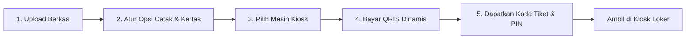

# 🖨️ Cepatik — Self-Service Cloud Printing Kiosk

> **Cepatik** adalah platform aplikasi web cetak mandiri (*self-service cloud printing kiosk*) modern yang dirancang khusus untuk ekosistem mahasiswa dan kampus. Memungkinkan mahasiswa mencetak tugas, skripsi, dan dokumen lainnya dari mana saja lewat smartphone/laptop, membayar instan via QRIS, dan mengambil hasil cetakan langsung di mesin printer kiosk 24/7 menggunakan kode tiket tanpa antre di meja operator.

---

## 👥 Identitas Pengembang & Pembagian Tugas (Kelompok)

Proyek ini dikembangkan secara kolaboratif untuk tugas mata kuliah **Pemrograman Web (PemWeb)** dengan pembagian peran modul yang alami dan terstruktur:

| No | Nama Anggota | GitHub Username | Fokus Modul & Tanggung Jawab Utama |
|---|---|---|---|
| 1 | **Zahra Zusseta Stiawan** | [@LouOfJoe-Git](https://github.com/LouOfJoe-git) | **Anggota A — Sisi Pengguna (Front-Office):**<br>• Bertanggung jawab penuh atas tampilan awal dan alur pemesanan mahasiswa.<br>• Halaman Beranda (`index.html` / `index.php`) & Wizard Pemesanan (`cetak.html` / `cetak.php`).<br>• Kalkulator estimasi biaya instan, drag-drop dokumen berkas, skema dataset JSON, master tarif, Class `Order`, serta `HomeController`, `CetakController`, dan `TarifModel` (MVC). |
| 2 | **Damar Ghulamul Abror** | [@DamarAbror-Git](https://github.com/DamarAbror-Git) | **Anggota B — Sisi Operator & Admin (Back-Office):**<br>• Bertanggung jawab penuh atas sistem keamanan, autentikasi, dan panel monitoring loker.<br>• Portal Login Operator (`login.html` / `login.php`) & Dashboard Monitoring (`admin.html` / `admin.php`).<br>• Styling tabel antrean & struk thermal kasir, database engine `CepatikDB`, sinkronisasi real-time & Zero-Retention, Class `Kiosk`, serta `BaseController`, `AdminController`, `OrderModel`, `KioskModel`, dan Unit Testing 60 skenario (MVC). |

---

## 📅 Roadmap Perkuliahan & Navigasi Mingguan (Week 2 – Week 7)

Setiap minggu pengerjaan dikemas dalam folder mandiri yang dapat diuji secara langsung oleh dosen dan asisten praktikum:

| Minggu | Topik Pembelajaran | Folder Proyek | Status |
|:---:|---|:---:|:---:|
| **Week 2** | **HTML5 & CSS3** | [`/Week2`](./Week2/) | ✅ Selesai (100%) |
| **Week 3** | **JavaScript, DOM & Events** | [`/Week3`](./Week3/) | ✅ Selesai (100%) |
| **Week 4** | **API, JSON & Asynchronous** | [`/Week4`](./Week4/) | ✅ Selesai (100%) |
| **Week 5** | **PHP Prosedural & Formula Bisnis** | [`/Week5`](./Week5/) | ✅ Selesai (100%) |
| **Week 6** | **PHP OOP (Object-Oriented Programming)** | [`/Week6`](./Week6/) | ✅ Selesai (100%) |
| **Week 7** | **Arsitektur PHP MVC (Model-View-Controller)** | [`/Week7`](./Week7/) | ✅ Selesai (100%) |

---

## ✨ Fitur Utama Sistem Cepatik

### 1. 🌐 Portal Landing Page & Pemesanan Mandiri (Modul Zahra)
- **Kalkulator Tarif Real-Time**: Simulasi biaya cetak langsung berdasarkan jenis kertas, tinta warna/hitam-putih, jumlah halaman, dan diskon otomatis *duplex* (bolak-balik) 5%.
- **Live Antrean Cloud & Status Kiosk**: Menampilkan metrik operasional printer kiosk mitra secara *live*.
- **Quick Order Tracker**: Fitur lacak pesanan instan menggunakan kode tiket (cth: `CPT-8492`) yang terintegrasi dengan database antrean real-time.
- **Wizard Pemesanan 5 Langkah (`cetak.php`)**:
  - Langkah 1: Unggah berkas (PDF, DOCX, PPTX) dengan sistem drag-and-drop.
  - Langkah 2: Kustomisasi kertas (A4 75g, A4 80g, F4 80g), tinta (BW/Warna), duplex, dan jilid.
  - Langkah 3: Pilih titik kiosk terdekat di kampus.
  - Langkah 4: Pembayaran QRIS instan dengan countdown timer.
  - Langkah 5: Penerbitan Kode Tiket unik dan PIN loker mandiri.

### 2. 🔒 Portal Keamanan & Dashboard Operator (Modul Damar)
- **Portal Login Operator & Super Admin (`login.php`)**: Sistem keamanan berbasis peran lokasi kiosk penugasan.
- **Dashboard Monitoring Antrean Real-Time (`admin.php`)**: Pembaruan status cetak seketika (Menunggu Cetak ➔ Sedang Diproses ➔ Siap Diambil ➔ Selesai).
- **Cetak Struk Thermal Loker**: Format cetak struk kasir thermal 58mm/80mm menggunakan browser print (`@media print`).
- **Zero-Retention Enforcement**: Berkas dokumen otomatis dimusnahkan secara permanen dari memori saat pesanan selesai demi keamanan data mahasiswa.
- **Automated QA Testing Suite**: 60 rangkaian unit test otomatis untuk menjamin keandalan seluruh fungsi dan router aplikasi.

---

## 🔄 Alur Kerja Sistem



---

## 📁 Struktur Direktori Repository

```text
PemWeb-master/
├── Week2/                   # [WEEK 2: HTML5 & CSS3]
├── Week3/                   # [WEEK 3: JAVASCRIPT, DOM & EVENTS]
├── Week4/                   # [WEEK 4: API, JSON & STORAGE]
├── Week5/                   # [WEEK 5: PHP PROSEDURAL]
├── Week6/                   # [WEEK 6: PHP OOP]
├── Week7/                   # [WEEK 7: PHP MVC LENGKAP]
├── index.php                # Portal Navigasi Utama Evaluasi Praktikum
├── start_server.bat         # Skrip 1-Klik Menjalankan Server Lokal Cepatik
└── README.md                # Dokumentasi Utama
```

---

## 🚀 Panduan Menjalankan Proyek

### 1. Menjalankan Server Lokal (Paling Mudah)
Cukup **klik dua kali file `start_server.bat`**, peramban akan otomatis terbuka di `http://localhost:8000` menuju Portal Navigasi Cepatik.

Atau jalankan melalui terminal:
```bash
php -S localhost:8000
```

### 2. Menjalankan Unit Testing Otomatis
Untuk memvalidasi integritas logika, objek OOP, dan arsitektur MVC (60 test):
```bash
php Week7/test_suite.php
```

---

## 👥 Lisensi & Hak Cipta

- **Lisensi**: [MIT License](LICENSE) — Bebas digunakan untuk referensi pembelajaran dan praktikum.
- **Hak Cipta**: © 2026 Cepatik Cloud Printing Kiosk — Zahra Zusseta & Damar Abror.
