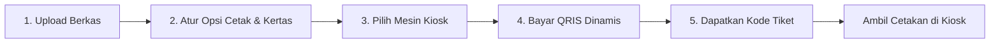

# 🖨️ Cepatik — Self-Service Cloud Printing Kiosk

> **Cepatik** adalah platform aplikasi web cetak mandiri (*self-service cloud printing kiosk*) modern yang dirancang khusus untuk ekosistem mahasiswa dan kampus. Memungkinkan mahasiswa mencetak tugas, skripsi, dan dokumen lainnya dari mana saja lewat smartphone/laptop, membayar instan via QRIS, dan mengambil hasil cetakan langsung di mesin printer kiosk 24/7 menggunakan kode tiket tanpa antre di meja operator.

---

## 📌 Daftar Isi

- [Latar Belakang & Fitur Utama](#-fitur-utama)
- [Tangkapan Layar & Alur Sistem](#-alur-kerja-sistem)
- [Struktur Direktori](#-struktur-direktori)
- [Teknologi yang Digunakan](#-teknologi-yang-digunakan)
- [Panduan Menjalankan Proyek](#-panduan-menjalankan-proyek)
- [Rincian Halaman & Komponen](#-rincian-halaman--komponen)
- [Kalkulasi Tarif & Simulasi](#-skema-biaya--kalkulator)
- [Kontribusi & Lisensi](#-lisensi)

---

## ✨ Fitur Utama

### 1. 🌐 Portal Landing Page Interaktif (`index.html` & `index.php`)
- **Kalkulator Tarif Real-Time**: Simulasi biaya cetak langsung berdasarkan jenis kertas, tinta warna/hitam-putih, jumlah halaman, dan diskon otomatis *duplex* (bolak-balik) 5%.
- **Live Antrean Cloud & Status Kiosk**: Menampilkan metrik operasional printer kiosk mitra secara *live*.
- **Quick Order Tracker**: Fitur lacak pesanan instan menggunakan kode tiket (cth: `CPT-8492`) yang terintegrasi dengan database antrean real-time.
- **Peta & Titik Lokasi Kiosk**: Informasi ketersediaan stok kertas, jam buka, dan status printer di berbagai titik kampus (UI, ITB, UGM, dsb) lengkap dengan tautan peta lokasi.
- **Fast Upload Dropzone**: Drag-and-drop berkas langsung dari beranda yang otomatis meneruskan berkas ke aplikasi pemesanan (`sessionStorage`).

### 2. 📝 Aplikasi Wizard Pemesanan 5 Langkah (`cetak.html` & `cetak.php`)
- **Langkah 1: Unggah Berkas & Validasi**:
  - Mendukung format `.pdf`, `.docx`, `.pptx`, `.jpg`, `.png`.
  - Auto-deteksi estimasi halaman dan kalkulasi format ukuran file (KB/MB).
- **Langkah 2: Opsi Cetak & Finishing**:
  - Pilihan kertas: *A4 Standar (75 GSM)*, *A4 Tebal (80 GSM)*, dan *F4 Folio (80 GSM)*.
  - Mode tinta: *Hitam Putih (B/W)*, *Warna Standar*, dan *Full Color Foto*.
  - Sisi cetak: *Simplex (1 Sisi)* atau *Duplex (Bolak-Balik)* dengan diskon hemat kertas 5%.
  - Opsi penjilidan: *Tanpa Jilid*, *Steples Pojok*, dan *Jilid Lakban Mika*.
  - Jumlah rangkap/salinan yang dapat diatur fleksibel.
- **Langkah 3: Pemilihan Mesin Kiosk**:
  - Pemilihan titik kiosk terdekat dengan informasi ketersediaan kertas siap cetak.
- **Langkah 4: Pembayaran QRIS Dinamis**:
  - Mockup visual QR Code Standar Pembayaran Nasional (QRIS).
  - Countdown timer mundur 15 menit untuk batas waktu pembayaran.
  - Tombol simulasi bayar instan.
- **Langkah 5: Tiket Pengambilan Pesanan**:
  - Penerbitan kode unik tiket pesanan (cth: `CPT-xxxx`) sebagai kunci tunggal untuk memproses/mengambil dokumen di layar mesin kiosk.
  - Tombol **Cetak Struk Tiket** (`window.print()`).
  - Data pesanan otomatis disimpan ke database antrean terpusat (`db/database.js`).
- **Live Order Summary Sidebar**: Rincian pesanan dan total biaya selalu ter-update secara *real-time* di panel sisi kanan.

### 3. 🔒 Keamanan & Privasi Mahasiswa
- Menampilkan konsep *Zero Data Retention* (file dokumen otomatis terhapus dari server dalam 2 jam setelah pencetakan).
- Pengambilan hasil cetak aman terlindungi dengan validasi Kode Tiket unik pada layar sentuh mesin kiosk.

---

## 🔄 Alur Kerja Sistem



1. **Unggah Dokumen**: Mahasiswa memilih dokumen dari perangkat (HP/Laptop).
2. **Kustomisasi**: Menyesuaikan kebutuhan kertas, tinta warna, rangkap, dan jilid.
3. **Pilih Lokasi**: Memilih titik kiosk terdekat di area kampus.
4. **Bayar**: Melakukan pembayaran non-tunai melalui QRIS.
5. **Pengambilan**: Datang ke kiosk, masukkan Kode Tiket pada layar sentuh kiosk, dan dokumen langsung tercetak rapi.

---

## 📁 Struktur Direktori

```text
PemWeb-master/
├── assets/
│   ├── css/
│   │   └── style.css            # Desain sistem & styling lengkap (Landing, App, Admin, Login, & Thermal Print)
│   ├── images/
│   │   ├── icon.png             # Ikon aplikasi PNG
│   │   ├── icon.svg             # Ikon vektor aplikasi
│   │   ├── icon_base64.txt      # Data URI icon fallback
│   │   └── logo.svg             # Logo resmi Cepatik
│   └── js/
│       ├── admin.js             # Skrip logika dashboard admin & cetak thermal
│       ├── script.js            # Skrip logika beranda (Kalkulator biaya, live tracker tiket, hero queue)
│       └── sistem.js            # Skrip logika wizard aplikasi cetak mandiri 5 tahap
├── db/                          # Database layer terpusat (Single Source of Truth)
│   ├── antrean.json             # Dataset master antrean dan pesanan
│   ├── database.js              # Controller CepatikDB (CRUD, real-time pub/sub, zero-retention file purge)
│   └── kiosk.json               # Dataset master titik lokasi kiosk dan loker mandiri
├── admin.html                   # Dashboard panel admin kiosk & monitor antrean real-time
├── cetak.html                   # Aplikasi web pemesanan cetak mandiri 5 langkah (Wizard View)
├── cetak.php                    # Versi PHP alternatif pemesanan cetak
├── favicon.ico                  # Favicon tab browser
├── includes/                    # Modul data & fungsi PHP
│   ├── data.php                 # Master data PHP
│   └── functions.php            # Helper fungsi PHP
├── index.html                   # Landing page utama Cepatik
├── index.php                    # Versi PHP alternatif landing page
├── login.html                   # Portal autentikasi operator & pemilihan lokasi kiosk
├── main.html                    # Halaman redirect ke index.html
├── test_suite.php               # Unit test PHP suite
└── README.md                    # Dokumentasi lengkap proyek
```

---

## 🛠️ Teknologi yang Digunakan

| Komponen | Teknologi | Keterangan |
| :--- | :--- | :--- |
| **Markup** | HTML5 Semantik | Menggunakan elemen semantik (`<nav>`, `<header>`, `<main>`, `<section>`, `<article>`, `<aside>`, `<footer>`) |
| **Styling** | Vanilla CSS3 | Menggunakan CSS Custom Properties (`:root`), CSS Grid, Flexbox, layout `@media print` kertas thermal kasir 80mm, dan desain responsif |
| **Scripting** | Vanilla JavaScript (ES6+) | Logika reaktif murni tanpa framework eksternal, manipulasi DOM dinamis, pub/sub storage event, dan enkripsi klien |
| **Database Layer** | CepatikDB (`db/`) | Pengelolaan data antrean terpusat (`antrean.json`), manajemen sesi operator, dan auto-purge retensi privasi |
| **Aset Grafis** | Scalable Vector Graphics (SVG) | Ikon antarmuka modern yang tajam di berbagai resolusi layar tanpa dependensi pustaka font pihak ketiga |

---

## 🚀 Panduan Menjalankan Proyek

Aplikasi ini dibangun menggunakan teknologi web berbasis *client-side* murni, sehingga tidak memerlukan instalasi *backend server* atau database yang rumit.

### Opsi 1: Buka Langsung di Web Browser
1. Unduh / ekstrak repositori ini ke komputer Anda.
2. Klik dua kali (*double click*) file **`index.html`** untuk membuka beranda.
3. Klik file **`cetak.html`** untuk mencoba alur pemesanan cetak.
4. Klik file **`login.html`** atau **`admin.html`** untuk mengakses panel admin kiosk.

### Opsi 2: Menggunakan VS Code Live Server (Direkomendasikan)
1. Buka folder proyek di **Visual Studio Code**.
2. Pasang ekstensi **Live Server** (oleh Ritwick Dey) jika belum ada.
3. Klik kanan pada `index.html`, lalu pilih **"Open with Live Server"**.
4. Website akan otomatis terbuka di browser pada alamat `http://127.0.0.1:5500/index.html`.

### Opsi 3: Menggunakan Local Web Server (Node / Python / PHP)

- **Node.js (`npx serve`)**:
  ```bash
  npx serve .
  ```
- **Python 3**:
  ```bash
  python -m http.server 8000
  ```
  Lalu buka `http://localhost:8000` pada peramban web.
- **PHP Built-in Server**:
  ```bash
  php -S localhost:8000
  ```

---

## 📊 Skema Biaya & Kalkulator

| Komponen | Pilihan | Biaya / Lembar |
| :--- | :--- | :--- |
| **Warna Tinta** | Hitam Putih (B/W) | Rp 350 |
| | Warna Standar | Rp 1.000 |
| | Full Color Foto | Rp 2.000 |
| **Kertas** | A4 Standard (75 GSM) | +Rp 0 |
| | A4 Tebal (80 GSM) | +Rp 50 |
| | F4 Folio (80 GSM) | +Rp 100 |
| **Duplex** | Cetak Bolak-Balik | Diskon 5% total cetak |
| **Finishing** | Tanpa Jilid | Rp 0 |
| | Steples Pojok | +Rp 500 / set |
| | Jilid Lakban Mika | +Rp 3.500 / set |

---

## 👥 Pengembang & Lisensi

Proyek ini dibuat sebagai implementasi proyek tugas mata kuliah **Pemrograman Web (PemWeb)** dengan konsep inovasi solusi digital untuk mahasiswa.

- **Lisensi**: [MIT License](LICENSE) — Bebas digunakan untuk referensi pembelajaran dan pengembangan lebih lanjut.
- **Hak Cipta**: © 2026 PT Cepatik Teknologi Nusantara / Tim PemWeb.
